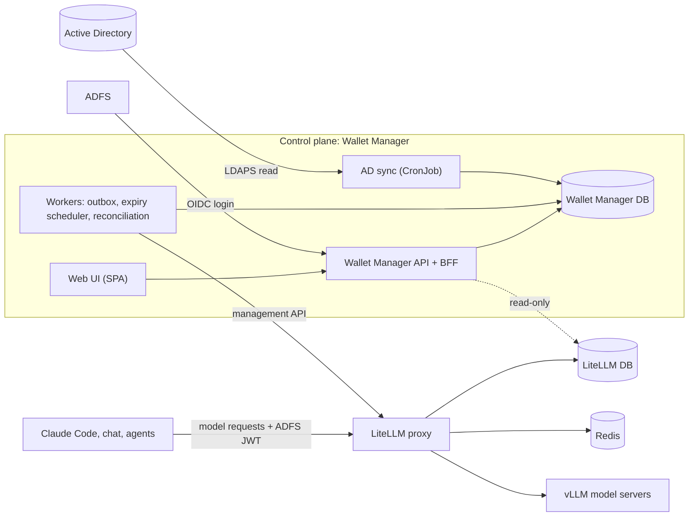

# Wallet Manager for LiteLLM: Requirements and Specification

Version 0.2 · 2026-10-19 · Status: ready for implementation planning

This document specifies a web system ("Wallet Manager") that lets an organization allocate model budgets, per-model allowances and concurrency limits down an organizational hierarchy, on top of a LiteLLM Enterprise proxy. It has a web UI for every role, and a backend server that sits between the UI and LiteLLM. LiteLLM remains the runtime enforcement engine. The Wallet Manager owns allocation decisions, validates them, writes them to LiteLLM through its management API, keeps them in sync with Active Directory, and reports on them.

Companion file: `litellm_wallets_erd.mmd` (Mermaid ERD of the LiteLLM tables this system writes to).

Changes in 0.2: system architecture (section 5), managers' personal wallets (4.1, FR-G5), employee self-view (FR-E), web UI and UX (section 12), UI-facing API (11.1), UI phases in the delivery plan.

---

## 1. Glossary

| Hebrew | Term in this spec | LiteLLM object |
|---|---|---|
| מחלקה | Department | Organization (`LiteLLM_OrganizationTable`) |
| קבוצה | Group | Team (`LiteLLM_TeamTable`) |
| עובד / מפתח | Employee | User (`LiteLLM_UserTable`) + team membership (`LiteLLM_TeamMembership`) |
| מפתח (API) | Personal key | Virtual key (`LiteLLM_VerificationToken`), exactly one per employee |
| נציג מחלקה | Department representative | Organization member with role `org_admin` |
| ראש קבוצה | Group head | Team member with role `admin` |
| גוף פרויקטים | Projects body (PMO) | No LiteLLM object. A logical pool inside the department, owned by this system |
| מטה מחלקה | Department staff group | A regular Team under the department, for the representative, PMO staff and other department-level people |
| מענק | Grant | Time-limited budget given by the PMO to a group, then shared to employees |
| מכסה | Cap | A spend ceiling at some level |
| קופת מודל | Model pot | A per-model spend ceiling (`model_max_budget`) |
| ענף | Branch | Not modeled. Out of scope |

Budget units are LiteLLM spend units. The organization's internal model price list makes one unit equal one credit (see section 18).

---

## 2. Goals and non-goals

### 2.1 Goals
- G1. A department representative splits the department budget between groups, a PMO pool and a reserve.
- G2. A group head splits the group budget between employees, as personal caps.
- G3. The PMO grants time-limited budget to a group for a project. The group head shares it to the employees who work on the project. Unused grant money returns to the PMO pool when it expires or when the employee leaves the group.
- G4. Per-model allowances: a group-level pot for a specific model, and per-employee caps for that model.
- G5. Per-employee concurrency (`max_parallel_requests`) and rate limits on the single personal key.
- G6. Membership follows Active Directory automatically: joiners, movers, leavers.
- G7. Guarantee, at allocation time, that no level allocates more than it received (LiteLLM does not check sums; see 3.3).
- G8. Production systems and group bots get keys that are not tied to a person.
- G9. Every person sees the state of their own wallet, and every manager sees the state of the wallets under them.
- G10. Reports: allocation versus spend at every level, grant usage, over-allocation, concurrency peaks.

### 2.2 Non-goals (this version)
- Branch level, LiteLLM Projects.
- Client-side login tooling for Claude Code (the `apiKeyHelper` script). Assume a valid ADFS JWT reaches LiteLLM.
- Per-employee per-model concurrency. LiteLLM has no native support; a custom hook is a possible later phase (section 14).
- Guaranteed GPU capacity. Concurrency limits are usage ceilings; the serving layer (vLLM) queues overload.
- Pixel-level visual design. Follow the organization's design system; this spec defines screens, content, actions and behavior.

---

## 3. LiteLLM behavior this design relies on

All items in 3.1 to 3.4 were verified against the LiteLLM source on the `main` branch in October 2026 (`schema.prisma`, `litellm/proxy/_types.py`, `litellm/proxy/auth/*`, `litellm/proxy/hooks/parallel_request_limiter_v3.py`, management endpoints). Items in 3.5 must be re-verified on the deployed version during phase 0.

### 3.1 Runtime enforcement (per request)
- R1. Budget checks run on every applicable scope, and any one of them blocks the request: key, team member, team, organization. Organization is resolved from `key.organization_id`, falling back to `team.organization_id`.
- R2. Team member budget lives in `LiteLLM_BudgetTable` via `LiteLLM_TeamMembership.budget_id`, and includes `temp_budget_increase` and `temp_budget_expiry`. The temporary increase stops counting automatically after the expiry, with no external job.
- R3. Team budget fields live directly on `LiteLLM_TeamTable` (`max_budget`, `budget_duration`, `model_max_budget`, `budget_limits`). There is no `budget_id` and no temporary increase at team level.
- R4. `User.max_budget` is not enforced for team keys unless `apply_user_budget_to_team_keys` is enabled. A per-person budget at organization level (`max_budget_in_organization`) is accepted by the API but was not found enforced at request time.
- R5. Per-model budgets (`model_max_budget`) are enforced at these scopes only: key, user, team, team member, end user. They are not enforced at organization or project level.
- R6. If a key has its own spend-gated `model_max_budget` entry for model X, LiteLLM skips the team's entry for X for that key. Therefore the system must never set `model_max_budget` on personal keys.
- R7. `max_parallel_requests` is enforced only on the key. Team, user and organization values exist in the schema but are not read by the limiter. The counter is a Redis sorted set, shared across pods. A slot is held for the whole request, including streaming, and is released on success, failure or client disconnect. A leaked slot self-expires after 3600 s. Over-limit returns HTTP 429 immediately.
- R8. Rate limits (rpm/tpm) apply at key, user, team, team member, organization and tag scope, plus per-model per key, team, organization and project. The window is 60 s (`LITELLM_RATE_LIMIT_WINDOW_SIZE`). Per-model limits on keys and teams are stored in `metadata.model_tpm_limit` and `metadata.model_rpm_limit`.
- R9. Deployment-level `max_parallel_requests` is counted in process memory per worker, not shared. If unset, LiteLLM derives it from deployment `rpm`, then `tpm/1000*6`. Over-limit returns 429, with no queue.

### 3.2 Identity
- R10. JWT-to-virtual-key mapping (`LiteLLM_JWTKeyMapping`, endpoints `/jwt/key/mapping/*`) maps one claim value (for example `upn`) to one key. Claims are read only when the mapping is created. After that, the key's `team_id` is whatever the key says, regardless of later JWT claims.
- R11. `unregistered_jwt_client_behavior: reject` denies unmapped identities. `auto_register` creates a key with no limits, so it must not be used.
- R12. `team_id_upsert` creates a team with no organization and no budget, which means unlimited. It must stay disabled.
- R13. SCIM in LiteLLM updates memberships and blocks keys of deactivated users, but does not change `key.team_id`. It is not used.

### 3.3 Allocation-time checks LiteLLM does and does not do
- R14. Each team's `max_budget` must be ≤ its organization's `max_budget`, checked individually. The sum across teams is not checked.
- R15. Member caps are not checked against the team budget.
- R16. Sum checks exist only for rpm/tpm, when `tpm_limit_type` or `rpm_limit_type` is `guaranteed_throughput`.
- R17. Keys: `litellm.upperbound_key_generate_params` caps `max_budget`, `max_parallel_requests`, `tpm_limit` and `rpm_limit` on key generate and update, and fills missing values on generate.

### 3.4 Data integrity facts
- R18. There are no foreign keys on `TeamMembership.team_id`, `TeamMembership.user_id`, `VerificationToken.team_id` or `VerificationToken.user_id`. Deleting a team leaves orphans unless they are cleaned through the API.
- R19. LiteLLM caches keys, teams and memberships. All writes must go through the management API, never directly to the LiteLLM database. Reads from the LiteLLM database (read-only role) are allowed for reporting and diffing.

### 3.5 To re-verify on the deployed version (phase 0)
- V1. Field names and endpoints listed in section 10.
- V2. That team-level `max_parallel_requests` is still not enforced. The docs show a team example, but the code does not enforce it.
- V3. That organization-level `model_max_budget` is still not enforced (R5).
- V4. Exact config placement of `upperbound_key_generate_params`, `apply_user_budget_to_team_keys`, `fail_closed_rate_limit_enforcement`, JWT settings and Redis settings.
- V5. That `temp_budget_increase` on a team member expires on time without any external action.

---

## 4. Target model

```
Department (Organization)            max_budget = groups' base + PMO pool + reserve
 ├─ Group (Team)                     max_budget = base + Σ active grants to this group
 │   ├─ Employee (User + TeamMembership)
 │   │     member budget: max_budget_in_team = personal base cap
 │   │                    temp_budget_increase = Σ active grant shares, expiry = earliest share expiry
 │   │                    model_max_budget = personal per-model caps
 │   │   └─ Personal key (exactly one)   max_parallel_requests, rpm_limit, model_tpm_limit
 │   │                                     mapped from ADFS JWT claim upn
 │   └─ Group service key (bots, agents)  user_id = null, own max_budget and max_parallel_requests
 ├─ Department staff group (Team)    a regular group for department-level people (4.1)
 └─ PMO pool (logical, this system only)
Production (separate Organization per department)
 └─ System (Team) └─ Service keys
```

Design rules:
- DR1. One personal key per employee. Its `team_id` equals the employee's current group.
- DR2. The employee's department is never set on the user or key. It is derived from the team (R1).
- DR3. Personal keys never carry `model_max_budget` (R6). Personal per-model caps go on the team membership.
- DR4. Production keys live in a separate Organization, so employee spending can never block production through the department cap.
- DR5. The Wallet Manager owns all allocation fields listed in 8.1. LiteLLM UI write access is limited to platform admins. Drift is corrected by reconciliation (FR-RC).

### 4.1 Managers' personal wallets
- DR6. Managing a wallet and spending from one are separate. Every person who holds a management role is also an ordinary employee: one personal key, a membership in exactly one group, and a personal cap in that group.
- DR7. A group head is a member of the group they manage. Their personal cap is part of that group's budget.
- DR8. Department representatives and PMO staff are members of the department staff group, a regular Team under the department whose base budget the representative allocates like any other group. A person cannot spend directly from the department, because LiteLLM does not enforce per-person budgets at organization level (R4).
- DR9. No one sets their own personal values: base cap, model caps, concurrency, rpm, or grant shares to themselves. The next level up sets them: a group head's values are set by the department representative; a department representative's values are set by a platform admin; a platform admin's values are set by another platform admin. The API rejects self-targeted changes with `SELF_ALLOCATION_FORBIDDEN`, and the UI shows these values as read-only with the name of the role that can change them.

---

## 5. System architecture



### 5.1 Components

| Component | Responsibility | Deployment |
|---|---|---|
| Web UI | Role-aware screens (section 12). Talks only to the Wallet Manager API | Static SPA served by the API or a web server |
| Wallet Manager API + BFF | OIDC login with ADFS, session cookie, roles from AD groups, validation, writes to its own DB and outbox, read models for the UI | OpenShift Deployment, 2+ replicas |
| Wallet Manager DB | Allocations, grants, policies, sync results, outbox, audit | PostgreSQL, separate from LiteLLM's database |
| Outbox worker | Applies pending writes to LiteLLM through the management API, with retries | OpenShift Deployment, single active consumer |
| Scheduler | Grant and share expiry, temporary-increase recomputation (FR-P4), reconciliation (FR-RC), scheduled reports | Same image as the worker, separate Deployment |
| AD sync | Reads AD, computes actions, safety gate (section 9) | OpenShift CronJob |
| LiteLLM | Runtime enforcement on every model request | Existing |

### 5.2 Why a server between the UI and LiteLLM
- The LiteLLM proxy-admin key has full rights and must never reach a browser.
- LiteLLM does not check sums, has no PMO concept, no grants, and no self-allocation rule. These live in the Wallet Manager.
- Roles come from AD groups and are scoped per department and group. LiteLLM roles cannot express the PMO role or the self-allocation rule.
- The outbox keeps the Wallet Manager and LiteLLM consistent when LiteLLM is unavailable.
- Reports join allocation data (Wallet Manager DB) with spend data (LiteLLM DB, read-only).

### 5.3 Write path
1. UI sends a change with a reason and an idempotency key.
2. API checks the role and scope, runs validations under a per-parent advisory lock, writes domain rows, an audit row and outbox rows in one transaction, and returns `pending` with the new values.
3. The outbox worker calls LiteLLM, marks rows `applied` or `failed`, and retries failures with backoff.
4. The UI shows `pending`, `applied` or `failed` per changed entity (12.3).

### 5.4 Failure modes

| Failure | Effect | Behavior |
|---|---|---|
| Wallet Manager down | No allocation changes | Model traffic is unaffected. LiteLLM keeps enforcing the last applied values. Member temporary increases still expire on time inside LiteLLM |
| LiteLLM management API down | Changes cannot be applied | Changes are accepted and queued in the outbox. The UI shows `pending` and a banner |
| LiteLLM database unreachable for reads | No fresh spend data | UI shows the last known spend with its timestamp |
| AD unreachable or partial result | No membership changes | Sync run aborts (safety gate) and alerts |
| Redis down | Rate and concurrency counters unavailable | LiteLLM with fail-closed returns 503 to model requests. Not a Wallet Manager concern, but shown on the admin status screen |

---

## 6. Actors and permissions

Roles are derived from AD group membership at login and refreshed on every session renewal.

| Role | Scope | Can |
|---|---|---|
| Employee | Self | See their own wallet (FR-E). Every authenticated user has this role |
| Group head | One group | Set employees' base caps, share grants to employees, set personal model caps, set concurrency within the allowed range, manage group service keys. Not for themselves (DR9) |
| PMO | One department | Create, change and close grants to groups in the department, from the PMO pool |
| Department representative | One department | Split the department into groups' base budgets, PMO pool and reserve. Set group model pots. Set group heads' personal values. Handle sync items for the department |
| Platform admin | Global | Departments, production organizations, policies, sync and outbox operations. Set department representatives' personal values |
| Viewer | Any scope | Read the screens of that scope, no actions |
| Sync service | Global | Provisioning actions from AD only (section 9) |

A person can hold several roles, for example group head and employee. The UI lets them switch between scopes (12.1).

The sync job also mirrors roles into LiteLLM (`org_admin` on the organization membership, `admin` on the team member) so the LiteLLM UI shows consistent read access.

---

## 7. Functional requirements

### 7.1 Department allocation (FR-D)
- FR-D1. Set a department budget and budget period (platform admin).
- FR-D2. Split it: base budget per group (including the department staff group), PMO pool size, reserve. Reject if Σ group bases + PMO pool + reserve > department budget.
- FR-D3. Set a group's model pot for model X (`team.model_max_budget[X]`). Reject if Σ group pots for X > the department's declared allowance for X. That allowance is a Wallet Manager value, since LiteLLM does not enforce per-model caps at organization level (R5).
- FR-D4. Set a group's tpm limit and per-model tpm limits (`team.tpm_limit`, `team.model_tpm_limit`).
- FR-D5. Set group heads' personal values (DR9).

### 7.2 Group allocation (FR-G)
- FR-G1. Set each employee's base cap (`max_budget_in_team`). Reject if Σ base caps > group base budget, unless the group's over-allocation factor allows it (policy, default 1.0).
- FR-G2. Set the defaults for new members: cap (`team_member_budget`, `team_member_budget_duration`) and per-model caps (`team_member_model_max_budget`).
- FR-G3. Set personal model caps (member `model_max_budget[X]`). Reject if Σ personal caps for X > the group's pot for X × over-allocation factor.
- FR-G4. Set personal concurrency and rpm on the personal key, within `[min, max]` defined by platform policy (upper bound also enforced by R17).
- FR-G5. Reject any change whose target is the actor's own employee record (DR9), with `SELF_ALLOCATION_FORBIDDEN`.

### 7.3 Grants (FR-P)
- FR-P1. PMO creates grant G: target group, amount A, optional model X, start, expiry E, project reference, free-text purpose. Reject if A > available PMO pool.
- FR-P2. On activation: `team.max_budget += A`. If X is set: `team.model_max_budget[X] += A`.
- FR-P3. Group head creates shares of G: employee, amount a, expiry e ≤ E. Reject if Σ shares of G > A. A group head cannot share to themselves (FR-G5); the department representative can.
- FR-P4. For each employee, the member's `temp_budget_increase` = Σ of the employee's active shares, and `temp_budget_expiry` = the earliest expiry among them. LiteLLM holds a single value and expiry (R2). When the earliest share expires, the system recomputes and writes the next value. If the system is down, LiteLLM drops the whole increase at expiry, so it fails toward less budget.
- FR-P5. If X is set, a share also raises the employee's personal cap for X by a, and lowers it back on close.
- FR-P6. Close a grant at expiry, on PMO request, or partially when an employee leaves the group (move in 9.3): compute used and unused amounts (7.3.1), return unused money to the PMO pool, and decrease `team.max_budget` (and the pot for X) by the unused amount of closed shares plus the unshared remainder.
- FR-P7. PMO can extend a grant's expiry or increase its amount (subject to FR-P1). Decreasing below the shared amount is rejected.
- FR-P8. Grants never cross departments. A cross-department project needs one grant per department.

#### 7.3.1 Usage attribution (default policy, configurable)
Within a budget period, an employee's spend counts against the base cap first, then against active shares in order of earliest expiry. For a share s:
`used(s) = clamp(member_spend_in_period − base_cap − used(earlier shares), 0, s.amount)`.
Member spend comes from `LiteLLM_TeamMembership.spend`, or from `LiteLLM_SpendLogs` by user, team and time window when the grant spans a period reset.

### 7.4 Employee self-view (FR-E)
- FR-E1. Every employee sees their own wallet: base cap, active shares, total, used, remaining, reset date, per-model caps and usage, concurrency and rpm limits, and usage history.
- FR-E2. Show the binding constraint: if the group or department is closer to its limit than the employee's personal remaining, show that the employee may be blocked by the group or department even with personal budget left.
- FR-E3. Show who can change each value (group head, department representative) with their names from AD.

### 7.5 Production and service keys (FR-K)
- FR-K1. Create a production Organization with its own budget (platform admin).
- FR-K2. Create a system (Team) under it and service keys through `/key/service-account/generate`, with their own `max_budget`, `max_parallel_requests`, `rpm_limit` and allowed models.
- FR-K3. Create group service keys (bots, agents) on a group's Team, with their own `max_budget` and `max_parallel_requests`. They draw from the group budget.
- FR-K4. Rotate and revoke service keys. Show a key secret exactly once at creation. Store only the hash.

### 7.6 Validation (FR-V)
- FR-V1. Every write runs the checks above inside a database transaction, with a per-parent advisory lock, so two concurrent allocations cannot over-allocate the same parent.
- FR-V2. A scheduled over-allocation report runs the checks against live LiteLLM values (section 11.3) and alerts on any breach, for example one caused by a manual change in the LiteLLM UI.

### 7.7 Reconciliation (FR-RC)
- FR-RC1. The Wallet Manager computes the desired LiteLLM state from its own database (8.1) and compares it to live LiteLLM values every N minutes (default 5).
- FR-RC2. It fixes drift through the API, logs every correction, and alerts when the same field drifts repeatedly.
- FR-RC3. Writes are idempotent. A write that fails is retried with backoff and stays marked `pending` until applied.

### 7.8 Reports (FR-R)
- FR-R1. Allocation versus spend for department, group and employee, per budget period, also per model.
- FR-R2. Grants: amount, shared, used, returned, by project.
- FR-R3. Over-allocation findings (FR-V2).
- FR-R4. Concurrency peaks per employee and globally, from `SpendLogs.startTime` and `endTime` overlaps.
- FR-R5. Spend of employees whose base cap or model cap reached 100% (blocked), per day.

### 7.9 Notifications (FR-N)
- FR-N1. In-app notifications, and email if an internal mail relay is available: employee at 80% and 100% of their cap; group at 80% and 100%; grant expiring in 7 days; grant under 20% used with 7 days left; new group created by sync with zero budget; sync items needing review; outbox failures (platform admins).
- FR-N2. Each user can mute non-critical notification types.

### 7.10 Audit (FR-A)
- FR-A1. Every change records: who, role, when, entity, before, after, reason, request id, and the resulting LiteLLM calls with status.

---

## 8. Data model (Wallet Manager's own database)

Separate PostgreSQL database or schema. Never in LiteLLM's schema.

### 8.1 Fields the Wallet Manager owns in LiteLLM

| LiteLLM object | Field | Desired value |
|---|---|---|
| Organization | `max_budget`, `budget_duration` | Department budget |
| Team | `organization_id` | Department of the group |
| Team | `max_budget` | Group base + Σ active grants |
| Team | `model_max_budget` | Group pots + Σ active model grants |
| Team | `tpm_limit`, `model_tpm_limit` (stored in `metadata`) | Group limits |
| Team | `team_member_budget`, `team_member_budget_duration`, `team_member_model_max_budget` | Defaults for new members |
| Team member | `max_budget_in_team`, `budget_duration` | Personal base cap |
| Team member | `temp_budget_increase`, `temp_budget_expiry` | Σ active shares, earliest expiry |
| Team member | `model_max_budget` | Personal model caps + model shares |
| Team member | `role` | `admin` for group heads |
| Organization member | `user_role` | `org_admin` for department representatives |
| User | `user_id` = upn, `sso_user_id` | Identity |
| Personal key | `user_id`, `team_id`, `max_parallel_requests`, `rpm_limit`, `model_tpm_limit` (stored in `metadata`), `blocked` | Per policy |
| JWT mapping | `jwt_issuer`, `jwt_claim_name` = `upn`, `jwt_claim_value`, `token` | One per employee |

### 8.2 Tables

```sql
department      (id, litellm_org_id, name, ad_group_dn, budget, budget_period,
                 pmo_pool, reserve, created_at, updated_at)
department_model_allowance (department_id, model, amount)        -- FR-D3
grp             (id, litellm_team_id, department_id, name, ad_group_dn,
                 kind,                                            -- regular | department_staff
                 base_budget, default_member_cap, overalloc_factor default 1.0,
                 tpm_limit, model_tpm_limits jsonb, status)       -- active | pending_dept_move | archived
group_model_pot (group_id, model, amount)
employee        (upn PK, display_name, litellm_user_id, group_id, base_cap, status, -- active | blocked | left
                 key_token_hash, max_parallel, rpm_limit, model_tpm_limits jsonb,
                 left_at)
employee_model_cap (upn, model, amount)
grant           (id, department_id, group_id, amount, model null, project_ref, purpose,
                 starts_at, expires_at, status,                   -- pending | active | closed
                 created_by, closed_at, used, returned)
grant_share     (id, grant_id, upn, amount, expires_at, status,   -- active | closed
                 used, returned, closed_reason)                   -- expiry | move | manual
service_key     (id, owner_kind, owner_id, litellm_token_hash, alias, max_budget,
                 max_parallel, rpm_limit, models text[], status)
policy          (key, value jsonb)  -- concurrency min/default/max, rpm default, over-allocation, thresholds
role_binding    (ad_group_dn, role, scope_kind, scope_id)
sync_run        (id, started_at, finished_at, dry_run, stats jsonb, aborted_reason)
sync_action     (id, run_id, kind, upn, payload jsonb, status, error) -- status includes needs_review
litellm_write   (id, entity, entity_id, endpoint, payload jsonb, status, attempts,
                 last_error, idempotency_key, created_at)          -- outbox, FR-RC3
spend_snapshot  (scope_kind, scope_id, period, model null, spend, taken_at) -- cached for the UI
notification    (id, upn, kind, scope_kind, scope_id, payload jsonb, created_at, read_at)
notification_pref (upn, kind, muted)
audit_log       (id, at, actor_upn, actor_role, entity, entity_id, before jsonb,
                 after jsonb, reason, request_id)
```

Write path: validate, then write the domain rows and an outbox row (`litellm_write`) in one transaction, then a worker applies the outbox to LiteLLM (5.3).

---

## 9. Active Directory sync

### 9.1 Source data
- Dedicated AD security groups for budget groups, under a configured OU (for example `OU=LLM-Budget-Groups`). Each maps to one Team. One per department is the department staff group.
- Department of a group: an attribute on the AD group or its parent OU (configurable).
- Role groups: department representatives, PMO staff, group heads and platform admins, per scope.
- Read through LDAPS with a read-only service account.

### 9.2 Algorithm
Full desired-state reconciliation, not event-driven. Default interval 15 minutes, plus on-demand. Single instance (database advisory lock).

1. Read AD: users in scope, their budget-group membership, enabled or disabled, role groups.
2. Build desired state: employee → group → department, roles.
3. Read actual state from the Wallet Manager database and LiteLLM (read-only database access).
4. Diff into actions (9.3).
5. Safety gate: abort and alert if removals or moves exceed a threshold (default 5% of employees), or if AD returned zero users for any group that had members.
6. Apply through the outbox. Record a `sync_run` with stats.

Dry-run mode produces the action list and report without applying. Dry-run is the default for the first weeks after go-live. A platform admin can approve a dry-run or an aborted run from the UI (12.5.5).

### 9.3 Actions

| AD event | Actions, in order |
|---|---|
| Joiner | `/user/new` (user_id = upn) → `/team/member_add` with the group's default cap → `/key/generate` (user_id, team_id, max_parallel_requests, rpm_limit, model_tpm_limit) → `/jwt/key/mapping/new` (claim `upn`) |
| Move within or across departments | Close the employee's active grant shares with reason `move`, returning unused money to the PMO pool (FR-P6) → `/team/member_add` to the new group, default cap → `/key/update` with the new `team_id` → `/team/member_delete` from the old group |
| Leaver or disabled account | `/key/block` immediately → set the JWT mapping inactive → after a grace period (default 30 days): close shares, `/team/member_delete` |
| Re-enabled account | Unblock the key, re-activate the mapping, re-add membership if it was removed |
| New budget group in AD | `/team/new` with `organization_id` and `max_budget = 0`. Notify the department representative |
| Group moved to another department in AD | No automatic action. Mark the group `pending_dept_move` and notify both representatives and the platform admin |
| Group removed from AD | No automatic action. Flag for review |
| Employee in two budget groups | No change. Flag for review |
| Role group change | `/team/member_update` role, `/organization/member_update` role |

The order in a move (add, repoint the key, remove) guarantees the key never points to a group the employee is not a member of.

Access revocation does not depend on this job. A disabled AD account cannot obtain an ADFS JWT, so access stops when the current token expires.

---

## 10. LiteLLM API surface used

Writes use a dedicated LiteLLM proxy-admin key, stored as an OpenShift secret.

| Purpose | Endpoint | Key fields |
|---|---|---|
| Department | `POST /organization/new`, `PATCH /organization/update` | `organization_alias`, `max_budget`, `budget_duration`, `models` |
| Department roles | `POST /organization/member_add`, `PATCH /organization/member_update` | `user_id`, `role` (`org_admin`) |
| Group | `POST /team/new`, `POST /team/update` | `team_id`, `team_alias`, `organization_id`, `max_budget`, `budget_duration`, `model_max_budget`, `tpm_limit`, `model_tpm_limit` (stored in `metadata`), `team_member_budget`, `team_member_budget_duration`, `team_member_model_max_budget` |
| Membership | `POST /team/member_add`, `POST /team/member_update`, `POST /team/member_delete` | `team_id`, `user_id`, `role`, `max_budget_in_team`, `budget_duration`, `temp_budget_increase`, `temp_budget_expiry` (both together), `model_max_budget`, `tpm_limit`, `rpm_limit` |
| User | `POST /user/new`, `POST /user/update` | `user_id`, `sso_user_id`, `user_email` |
| Personal key | `POST /key/generate`, `POST /key/update`, `POST /key/block`, `POST /key/unblock` | `user_id`, `team_id`, `max_parallel_requests`, `rpm_limit`, `model_tpm_limit` (stored in `metadata`) |
| Service key | `POST /key/service-account/generate` | `team_id`, `max_budget`, `max_parallel_requests`, `rpm_limit`, `models` |
| SSO mapping | `POST /jwt/key/mapping/new`, `/update`, `/delete`, `GET /jwt/key/mapping/list` | `jwt_issuer`, `jwt_claim_name`, `jwt_claim_value`, `key` or `token` |
| Info | `GET /team/info`, `GET /organization/info`, `GET /key/list` | |

Required LiteLLM configuration (exact placement per V4):
- JWT auth enabled, `virtual_key_claim_field: upn`, `unregistered_jwt_client_behavior: reject`, `team_id_upsert: false`.
- `JWT_PUBLIC_KEY_URL` pointing to the ADFS OIDC discovery or keys endpoint; `JWT_AUDIENCE`, `JWT_ISSUER`.
- Redis shared by all LiteLLM pods; `fail_closed_rate_limit_enforcement: true`.
- `upperbound_key_generate_params` with the organization-wide ceilings for `max_parallel_requests` and `rpm_limit`.
- No `max_parallel_requests` derived implicitly from deployment `rpm` (R9): set it explicitly per deployment or omit `rpm`.

---

## 11. Wallet Manager API

REST, JSON, OpenAPI generated. Authentication: session cookie issued by the BFF after ADFS OIDC login (12.8); service-to-service calls use ADFS JWT. Roles per section 6. Every write accepts `Idempotency-Key` and a required `reason`, and returns the affected entities with their sync status.

### 11.1 Endpoints

```
# Session and self
GET    /me                                      roles, scopes, display name, group
GET    /me/wallet?period=                       FR-E1, FR-E2, FR-E3
GET    /me/usage?from=&to=&granularity=day      own usage time series, per model
GET    /me/notifications | POST /me/notifications/{id}/read | PUT /me/notification-prefs

# Departments
GET    /departments, /departments/{id}/summary?period=
PUT    /departments/{id}/budget                 {budget, budget_period}
PUT    /departments/{id}/split                  {groups:[{group_id, base}], pmo_pool, reserve}
PUT    /departments/{id}/model-allowances       {model: amount}
GET    /departments/{id}/review-items           sync items, new groups at zero budget, pending moves

# Groups
GET    /groups/{id}/summary?period=
PUT    /groups/{id}/model-pots                  {model: amount}
PUT    /groups/{id}/limits                      {tpm_limit, model_tpm_limits}
PUT    /groups/{id}/member-defaults             {cap, model_caps}
GET    /groups/{id}/members?period=
PUT    /groups/{id}/members/caps                [{upn, base_cap}]        bulk, single transaction
PUT    /groups/{id}/members/{upn}/model-caps    {model: amount}
PUT    /groups/{id}/members/{upn}/limits        {max_parallel, rpm_limit, model_tpm_limits}

# PMO and grants
GET    /departments/{id}/pmo-pool?period=
POST   /grants                                  {group_id, amount, model?, starts_at, expires_at, project_ref, purpose}
PATCH  /grants/{id}                             {amount?, expires_at?}   FR-P7
POST   /grants/{id}/close                       {reason}
GET    /grants?department=&group=&status=&project_ref=
GET    /grants/{id}/shares
POST   /grants/{id}/shares                      [{upn, amount, expires_at}]
PATCH  /grants/{id}/shares/{share_id}           {amount?, expires_at?}
POST   /grants/{id}/shares/{share_id}/close     {reason}
GET    /projects/{project_ref}/summary          grants across groups of one project

# Service keys and production
POST   /service-keys                            {owner_kind: group|system, owner_id, alias, max_budget, max_parallel, rpm_limit, models}
POST   /service-keys/{id}/rotate | /revoke
POST   /production/departments/{id}/systems     {name, budget}

# Platform
GET    /policies | PUT /policies
POST   /sync/run?dry_run=true
GET    /sync/runs, /sync/runs/{id}
POST   /sync/runs/{id}/approve
POST   /sync/actions/{id}/resolve               {decision, note}
GET    /outbox?status=failed | POST /outbox/{id}/retry
GET    /status                                  LiteLLM reachability, Redis status from LiteLLM health, last sync, outbox depth

# Reports and audit
GET    /reports/allocation?level=&id=&period=
GET    /reports/usage?scope=&id=&from=&to=&granularity=&by=model|member
GET    /reports/grants?department=&project_ref=
GET    /reports/overallocation
GET    /reports/concurrency-peaks?scope=&id=&from=&to=
GET    /audit?entity=&id=&actor=&from=&to=
```

### 11.2 Error contract
Validation failures return 422 with a machine-readable code and the numbers involved: requested, available, parent total. Codes: `PARENT_OVERALLOCATED`, `PMO_POOL_INSUFFICIENT`, `SHARE_EXCEEDS_GRANT`, `SHARE_EXPIRY_AFTER_GRANT`, `LIMIT_OUT_OF_POLICY`, `SELF_ALLOCATION_FORBIDDEN`, `SCOPE_FORBIDDEN`, `GRANT_BELOW_SHARED`. The UI maps each code to a Hebrew message (12.6).

### 11.3 Over-allocation checks against live LiteLLM values

```sql
-- Departments whose groups' budgets exceed the department budget
SELECT o.organization_alias, b.max_budget AS dept_budget, SUM(t.max_budget) AS allocated
FROM "LiteLLM_OrganizationTable" o
JOIN "LiteLLM_BudgetTable" b ON b.budget_id = o.budget_id
JOIN "LiteLLM_TeamTable"   t ON t.organization_id = o.organization_id
GROUP BY o.organization_alias, b.max_budget
HAVING SUM(t.max_budget) > b.max_budget;

-- Groups whose members' caps, including active temporary increases, exceed the group budget
SELECT t.team_alias, t.max_budget AS group_budget,
       SUM(mb.max_budget + CASE WHEN mb.temp_budget_expiry > now()
                                THEN COALESCE(mb.temp_budget_increase, 0) ELSE 0 END) AS allocated
FROM "LiteLLM_TeamTable"      t
JOIN "LiteLLM_TeamMembership" m  ON m.team_id = t.team_id
JOIN "LiteLLM_BudgetTable"    mb ON mb.budget_id = m.budget_id
GROUP BY t.team_alias, t.max_budget
HAVING SUM(mb.max_budget + CASE WHEN mb.temp_budget_expiry > now()
                                THEN COALESCE(mb.temp_budget_increase, 0) ELSE 0 END) > t.max_budget;
```

The PMO pool is not in LiteLLM, so the first query should allow `allocated ≤ dept_budget − reserve`. The Wallet Manager computes the exact check from its own tables.

---

## 12. Web UI and UX

### 12.1 Principles
- Hebrew first, right-to-left layout. Numbers, model names and identifiers render left-to-right inside RTL text. Credits use thousands separators and no decimals; percentages one decimal. Dates `dd/mm/yyyy`, times in the configured timezone.
- Login through ADFS (browser OIDC). No passwords in the app.
- Role-aware home. A person with several roles gets a scope switcher in the top bar: "הארנק שלי", each group they head, each department they represent or serve as PMO, "פלטפורמה" for admins. The last selected scope is remembered per user.
- A budget period selector on every screen with money, defaulting to the current period. Past periods are read-only.
- One visual language for a wallet at every level (12.3), so a department, a group and a person read the same way.
- Every number a user can change shows who owns it. Values the user cannot change are read-only and name the role that can.
- Edits never auto-save. The user edits, sees a summary of changes and the remaining-to-allocate effect, enters a reason, and confirms.
- Server validation is authoritative. Client-side checks only preview it.
- After saving, changed values show a sync badge until LiteLLM confirms (`pending`, `applied`, `failed`).
- Spend data shows its freshness ("עודכן לפני 3 דקות").
- Desktop first (1280 px and up), usable on a laptop. Keyboard accessible, WCAG 2.1 AA contrast. Color is never the only signal.

### 12.2 Navigation and access matrix

| Screen | Employee | Group head | PMO | Dept rep | Platform admin | Viewer |
|---|---|---|---|---|---|---|
| הארנק שלי (my wallet) | Own | Own | Own | Own | Own | Own |
| הקבוצה (group) | | Edit own group | View groups in dept (grants tab) | View all groups in dept, edit pots and limits | Edit all | View scope |
| מענקים (grants, group view) | | Share to members | Create, change, close | View | Edit all | View scope |
| גוף פרויקטים (PMO) | | | Edit | View, set pool size | Edit all | View scope |
| המחלקה (department) | | | View | Edit split, pots, group heads' personal values | Edit all | View scope |
| ייצור (production) | | | | View own department | Edit | |
| פלטפורמה (platform) | | | | | Edit | |
| דוחות (reports) | Own | Own group | Own department grants | Own department | All | Scope |
| היסטוריה (audit) | Own record | Own group | Own grants | Own department | All | Scope |

### 12.3 Shared components and definitions

Wallet card, the same at every level:
- Total available this period, used, remaining, percent used as a bar with markers at 80% and 100%.
- Allocated to children and unallocated (for levels that allocate), with a warning if allocated exceeds the total.
- Reset date of the period.
- Binding constraint line (employee and group level): which level would block first.
- Per-model rows when model pots or caps exist.

Formulas, per budget period:

| Level | Total | Allocated to children | Unallocated | Used | Remaining |
|---|---|---|---|---|---|
| Department | budget B | Σ group bases + PMO pool + reserve | B − allocated | Σ spend of the department's groups | B − used |
| PMO pool | pool P | Σ active grant amounts | P − Σ active grants − Σ used of grants closed this period | Σ used of grants | Same as unallocated |
| Group | base b + Σ active grants | Σ member base caps + Σ active shares | total − allocated | team spend | total − used |
| Employee | base cap + Σ active shares | | | membership spend | total − used |
| Employee, effective | | | | | min(employee remaining, group remaining, department remaining) |

Other components:
- Allocation table: rows of children with editable numbers, a sticky footer showing total, allocated and remaining-to-allocate that updates as the user types, and row-level errors.
- Change summary dialog: before and after per row, the effect on the parent, a required reason field, confirm.
- Sync badge: `ממתין לסנכרון`, `עודכן`, `נכשל` with retry for admins.
- Usage chart: daily spend for the period, stacked by model, with the cap as a line.
- Grant list: project, amount, shared, used, expiry with days left, status.
- History timeline: audit entries for the entity, newest first, with actor, reason and before and after values.
- Empty, loading and error states for every table and card.

### 12.4 Wallet states and badges

| State | Rule | Shown as |
|---|---|---|
| Healthy | Used < 80% | Neutral |
| Near limit | 80% ≤ used < 100% | Warning |
| Blocked by own cap | Used ≥ 100% of own total | Danger, "חסום: המכסה האישית נוצלה" |
| Blocked by parent | Own remaining > 0 but group or department remaining ≤ 0 | Danger, "חסום: תקציב הקבוצה נוצל" or "תקציב המחלקה נוצל" |
| Over-allocated | Allocated to children > total | Warning on the allocating level |
| Pending sync | Outbox rows not applied | Info badge per entity |
| Left or blocked key | AD leaver or disabled | Muted row with reason |

### 12.5 Screens per role

#### 12.5.1 Employee: הארנק שלי
Purpose: understand what I can use, what I used, and why I might be blocked.

Shows:
- Wallet card for me (12.3), including the binding constraint.
- Per-model table: model, my cap (if any), used, remaining.
- Active project shares: project, amount, used, expiry with days left.
- Limits: concurrent requests and requests per minute, with a one-line explanation of what a 429 means and that clients retry.
- Group context: my group's percent used, with a warning when the group is near its limit.
- Usage chart for the period, by model.
- Who can change what: my group head (base cap, model caps, limits, shares), the department representative (for group heads).

Actions: none in this version except notification preferences. A "request more budget" action is a later phase.

#### 12.5.2 Group head: הקבוצה
Tabs:
1. Overview: group wallet card, per-model pots with used, grants received summary, top consumers this period, members near or at limit, pending sync items.
2. Members: table with name, base cap, active shares, total, used, percent, model caps, concurrency, rpm, status badge. Actions: edit base caps inline with the remaining-to-allocate footer; "distribute evenly" and "copy previous period" helpers that fill the table but still go through the change summary; edit a member's model caps and limits in a side panel; set defaults for new members. The group head's own row is read-only (DR9).
3. Grants: grants received from the PMO with amount, shared, unshared, used, expiry. Action: share a grant: choose members, amounts and expiry (default the grant's expiry, never later), see the unshared remainder update, confirm. Change or close an existing share.
4. Models: group pots per model (read-only, set by the department) and the sum of member caps per model against each pot.
5. Service keys: list with alias, budget, concurrency, used, status. Actions: create (the secret is shown once with a copy button and a warning), rotate, revoke.
6. History: audit timeline for the group.

Validations shown inline: sum of caps above group base (`PARENT_OVERALLOCATED`), share above grant remainder, share expiry after grant expiry, limit outside policy, self-allocation.

#### 12.5.3 PMO: גוף פרויקטים
Tabs:
1. Pool: pool card (size set by the department representative), active grants, used, returned, available.
2. Grants: table with project, group, amount, model, start, expiry, shared, used, returned, status; filters by project, group, status, expiring soon. Actions: create, extend, increase, close early.
3. Projects: one row per project reference, aggregating its grants across groups; drill into a project to see each group's grant and each share's usage.

Create grant wizard: project reference and purpose → target group (shows the group's current state) → amount (shows pool available, blocks above it) and optional model → dates → summary and confirm. After confirm, the group head is notified.

#### 12.5.4 Department representative: המחלקה
Tabs:
1. Overview: department wallet card, split chart (groups, PMO pool, reserve, unallocated), groups table with base, grants, total, used, percent and status, drill-down to any group in read mode.
2. Split: allocation table of group bases, PMO pool and reserve, with the remaining-to-allocate footer. The department staff group appears as a regular row.
3. Models: department allowance per model and group pots per model, with remaining per model.
4. Group heads: personal values of each group head (base cap, model caps, limits, shares), editable here and only here (DR9).
5. Review: items from sync for this department: new groups at zero budget (with a shortcut to allocate), groups pending a department move, employees in two budget groups, removed groups. Each item has resolve actions and a note.
6. Production: read-only view of the department's production organization, its systems and their spend.
7. History: audit timeline for the department.

#### 12.5.5 Platform admin: פלטפורמה
- Departments: create, set budget and period, assign representatives (from AD), create the production organization and systems.
- Sync: list of runs with stats, dry-run action lists, aborted runs with the reason, approve or discard; review queue across departments.
- Outbox and reconciliation: pending and failed writes with error text and retry; drift corrections log.
- Policies: concurrency minimum, default and maximum; rpm default; over-allocation factors; safety gate threshold; leaver grace period; notification thresholds.
- Status: LiteLLM reachability, last successful sync, outbox depth, spend data freshness.
- Personal values of department representatives (DR9).
- Audit search across everything.

#### 12.5.6 Viewer
The read-only version of the screens of the assigned scope, without action buttons.

### 12.6 Key flows

F1. Department split at the start of a period:
1. Representative opens Split. The table shows last period's values as the starting point.
2. Edits group bases, the PMO pool and the reserve. The footer shows remaining to allocate; it turns red if negative and Save is disabled.
3. Save opens the change summary with before, after and the effect on each group. The reason is required.
4. Confirm. Rows show `ממתין לסנכרון`, then `עודכן`. Group heads are notified of changes to their groups.

F2. Group head sets member caps:
1. Members tab, edit caps inline or use "distribute evenly".
2. The footer shows group base, allocated and remaining. Exceeding shows the row error and the server's numbers after Save if another user changed something in between.
3. Change summary, reason, confirm, sync badges.

F3. Project grant to employees:
1. PMO creates a grant for the group (12.5.3). The group head gets a notification with a link.
2. The group head opens the grant, selects the employees who work on the project, sets amounts and expiry, confirms.
3. Each employee sees the share in their wallet with its expiry.
4. At expiry, shares and the grant close automatically. Unused money returns to the PMO pool, and the group's total drops by the unused amount. The PMO sees used and returned per share.

F4. Employee is blocked:
1. Requests fail. The employee opens their wallet.
2. The binding constraint line says which level blocked them: their cap, the group, or the department.
3. The screen names who can change it, with contact details from AD.

F5. Employee moves to another group (from sync):
1. Sync closes the employee's shares in the old group. The PMO and the old group head see the returned amounts.
2. The employee appears in the new group with the default cap. The new group head is notified.
3. The employee's wallet shows the new group from the next refresh.

F6. A manager's own cap:
1. A group head opens their own row: it is read-only and names the department representative as the owner.
2. The representative changes it from the Group heads tab.

F7. Sync review:
1. The representative sees a review item, for example "employee in two budget groups".
2. They choose the primary group or mark it for the platform admin. The decision is recorded and the next sync run applies it.

### 12.7 Error messages
Every API error code maps to a Hebrew message with the numbers, for example `PARENT_OVERALLOCATED` → "חילקת 620,000 מתוך 600,000. יש להפחית 20,000 לפני שמירה". Messages name the next step, never only the failure.

### 12.8 Wireframes
Layout is mirrored for RTL in the product. Labels here are in English for clarity; UI text is in Hebrew.

```
MY WALLET                                              [Period: Oct 2026 v]
+--------------------------------------------------------------------------+
| Available 18,000   Used 12,400 (68.9%)   Remaining 5,600   Resets 01/11 |
| [███████████████████████████░░░░░░░░░░░░░]  80% |  100% |              |
| Limited by: you (group at 54%, department at 61%)                       |
+--------------------------------------------------------------------------+
| Models            Cap      Used     Remaining                            |
| model-x           3,000    2,100    900                                  |
+--------------------------------------------------------------------------+
| Project shares    Amount   Used     Expires                              |
| Project Atlas     3,000    1,000    31/12/2026 (73 days)                 |
+--------------------------------------------------------------------------+
| Limits: 4 concurrent requests · 120 requests/min                         |
| Changes: base cap, models, limits -> Dana Levi (group head)              |
+--------------------------------------------------------------------------+
```

```
GROUP: Group A1 · Members                              [Period: Oct 2026 v]
+--------------------------------------------------------------------------+
| Name          Base cap  Shares  Total   Used    %     Conc  Status       |
| Dana Levi*    15,000    0       15,000  9,100   60.7  4     (read-only)  |
| Dani Cohen    [15,000]  3,000   18,000  12,400  68.9  4     Healthy      |
| Yael Mizrahi  [15,000]  5,000   20,000  19,200  96.0  4     Near limit   |
| ...                                                                      |
+--------------------------------------------------------------------------+
| Group base 120,000 · Allocated 118,000 · Remaining to allocate 2,000     |
| [Distribute evenly] [Copy previous period]        [Review changes...]    |
+--------------------------------------------------------------------------+
* group head's own row is set by the department representative
```

```
DEPARTMENT · Split                                     [Period: Oct 2026 v]
+--------------------------------------------------------------------------+
| Department budget 1,000,000                                              |
| Group A1            [250,000]                                            |
| Group A2            [150,000]                                            |
| Group B1            [350,000]                                            |
| Department staff    [ 20,000]                                            |
| PMO pool            [180,000]                                            |
| Reserve             [ 50,000]                                            |
+--------------------------------------------------------------------------+
| Allocated 1,000,000 · Remaining to allocate 0       [Review changes...]  |
+--------------------------------------------------------------------------+
```

### 12.9 Data freshness and performance
- Spend is read from the LiteLLM database into `spend_snapshot` every 5 minutes (configurable). Screens read snapshots, never live heavy queries.
- Screens with up to 300 rows load in under 2 seconds at the 95th percentile.
- Allocation values are always live from the Wallet Manager database.

### 12.10 Frontend stack (unless the organization has a standard)
React with TypeScript and Vite; a component library with RTL support; TanStack Query for data fetching with optimistic display of `pending` values; a charting library that works offline; Playwright for end-to-end tests. All packages from the internal npm mirror. Authentication through the BFF: the browser holds only an httpOnly, SameSite session cookie; tokens stay on the server.

---

## 13. Non-functional requirements

- NFR1. Airgapped. No calls to the internet at build or run time. Dependencies come from the internal package mirrors.
- NFR2. Backend stack: Python 3.12, FastAPI, SQLAlchemy 2 (async) with asyncpg, Alembic, httpx, ldap3, Pydantic v2. PostgreSQL. Deploy on OpenShift: API as a Deployment, outbox worker and scheduler as separate Deployments, AD sync as a CronJob.
- NFR3. LiteLLM client isolated in one module with typed request models per endpoint, so a LiteLLM upgrade touches one place. Pin the LiteLLM version, with a contract test suite that runs against it (15.2).
- NFR4. Idempotent writes. Retries with exponential backoff. The outbox survives restarts.
- NFR5. No secret material in logs. The proxy-admin key is read from a secret at startup. Personal keys' plaintext is never stored. Personal keys are never shown to employees. Service key secrets are shown once.
- NFR6. Read access to the LiteLLM database uses a read-only database role.
- NFR7. Observability: structured logs, Prometheus metrics (outbox depth, sync actions per run, reconciliation drift count, validation rejections, spend snapshot age), health and readiness endpoints.
- NFR8. All times in UTC in storage and APIs. Budget periods and UI display use a configured timezone.
- NFR9. Web security: CSRF protection on all writes, strict Content Security Policy, server-side authorization on every endpoint regardless of what the UI shows.

---

## 14. Later phases (not in scope now)

- Per-employee per-model concurrency through a LiteLLM `async_pre_call_hook` with a Redis gauge keyed by key and model group, released on success, failure and disconnect.
- JWT-triggered moves: a LiteLLM hook compares the group claim in the JWT with `key.team_id` and enqueues a move, in place of LDAP polling.
- Self-service requests: an employee asks for a top-up, the group head approves, the PMO approves grant-backed requests.
- Forecasting: projected spend to the end of the period per wallet.

---

## 15. Testing and acceptance

### 15.1 Unit tests
Validation rules, attribution formula (7.3.1), earliest-expiry recomputation (FR-P4), self-allocation rule (FR-G5), wallet formulas (12.3), sync diffing (9.3), safety gate.

### 15.2 Contract and integration tests against a real LiteLLM
Docker Compose or an OpenShift test namespace: pinned LiteLLM version, PostgreSQL, Redis, a fake model backend (mock OpenAI-compatible server with controllable latency), two LiteLLM replicas.

Acceptance scenarios (phase 0 must pass V1 to V5 first):

| # | Scenario | Expected |
|---|---|---|
| A1 | Member with `temp_budget_increase` and expiry in 2 minutes | After expiry, requests beyond the base cap are blocked with no external action |
| A2 | Member caps sum above the team budget (bypassing the Wallet Manager) | LiteLLM blocks at the team cap; `/reports/overallocation` flags it |
| A3 | Personal key `max_parallel_requests = 3`, 6 concurrent slow requests across 2 replicas | Exactly 3 run, 3 get 429 |
| A4 | Redis stopped with fail-closed enabled | Requests get 503, not unlimited |
| A5 | Team pot for X = 10, member cap for X = 4, two members | Each member stops at 4; together they stop at 10 |
| A6 | `model_max_budget` set on a personal key (negative test) | Confirms R6: the team pot is skipped. The Wallet Manager never does this |
| A7 | Organization `model_max_budget` (negative test) | Confirms R5 on this version |
| A8 | Team `max_parallel_requests` (negative test) | Confirms V2 on this version |
| A9 | Move an employee with an active share | Share closed, unused amount back in the PMO pool, key on the new team, membership in the old team removed, no failed request during the move |
| A10 | JWT for an unmapped upn | 403 |
| A11 | Concurrent PMO grants that together exceed the pool | One succeeds, the other gets `PMO_POOL_INSUFFICIENT` |
| A12 | AD returns an empty result for a populated group | Sync aborts at the safety gate, nothing applied |
| A13 | Claude Code session with subagents against a key with the policy's default concurrency | Session completes, 429s are retried by the client |

### 15.3 UI end-to-end tests (Playwright)

| # | Scenario | Expected |
|---|---|---|
| U1 | Group head enters caps above the group base | Footer turns red, Save disabled; a race with another user returns `PARENT_OVERALLOCATED` with numbers |
| U2 | Group head tries to edit their own row or share a grant to themselves | Row read-only; API returns `SELF_ALLOCATION_FORBIDDEN` if called directly |
| U3 | Save while LiteLLM is down | Values saved, badges show pending, banner shown; badges turn applied after recovery |
| U4 | Employee whose group is exhausted but personal cap is not | Wallet shows "חסום: תקציב הקבוצה נוצל" and names the group head |
| U5 | PMO grant then group head share | Employee sees the share with expiry; PMO sees shared and unshared amounts |
| U6 | User with two roles | Scope switcher lists both scopes and the personal wallet; permissions follow the selected scope |
| U7 | Viewer | No action buttons; write endpoints return 403 |
| U8 | RTL rendering | Numbers and model names render correctly inside Hebrew text; tables mirror |

---

## 16. Delivery plan

| Phase | Backend | UI | Exit criteria |
|---|---|---|---|
| 0 | LiteLLM configuration, contract tests, verify V1 to V5 | | A1 to A8 and A10 pass |
| 1 | Data model, LiteLLM client, outbox, departments, groups, members, limits, validation, self-allocation rule, audit, BFF login | Shell, scope switcher, My wallet, Group (Overview, Members, History), Department (Overview, Split) | FR-D, FR-G, FR-E, FR-V, FR-A; A2, A3, A5; U1, U2, U3, U4, U6, U7, U8 |
| 2 | Grants and shares, scheduler for expiry and recomputation, reconciliation, notifications | PMO screens, Group Grants tab, Department Group heads tab | FR-P, FR-RC, FR-N; A1, A9 (manual move), A11; U5 |
| 3 | AD sync with dry-run and safety gate, role mirroring, service keys, production | Department Review and Production tabs, Group Service keys tab, Platform screens | Section 9, FR-K; A9, A12 |
| 4 | Reports and alerts | Reports screens, usage charts at every level | FR-R; concurrency peaks from SpendLogs |

---

## 17. Open decisions

| # | Decision | Default in this spec |
|---|---|---|
| D1 | Budget period | Monthly, calendar month, configured timezone |
| D2 | Attribution order between base cap and shares | Base first, then shares by earliest expiry |
| D3 | Grants that span a budget period reset | Allowed; usage measured from SpendLogs by time window |
| D4 | Member who moves mid-period: cap in the new group | The new group's default cap, full |
| D5 | Over-allocation factor for groups and model pots | 1.0 (no overbooking) |
| D6 | Concurrency policy: default, minimum and maximum per key | To be set from pilot measurements (FR-R4) |
| D7 | Who may raise an employee's concurrency above default | Group head within policy max; platform admin above it |
| D8 | Production Organization: one global or one per department | One per department |
| D9 | Internal price list per model, including cached input tokens | Required before go-live (section 18) |
| D10 | Grace period before removing a leaver's membership | 30 days |
| D11 | Who sees employee-level usage | Group head for their group; department representative for the department; PMO only per share of their grants; viewers only aggregates |
| D12 | Notification channel | In-app always; email if an internal relay exists |
| D13 | Department staff group | One per department, created by the platform admin at setup |

---

## 18. Credits and pricing

Credits are LiteLLM spend computed from per-model prices in the model configuration (`model_info` input and output cost per token). Claude Code resends long prefixes each turn, so cached input tokens need their own lower price, and vLLM must report cached tokens in `usage` for LiteLLM to price them. Verify this on the deployed versions before setting budgets, otherwise long sessions burn budget far faster than their real GPU cost.
